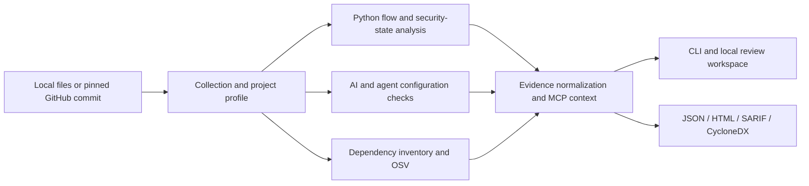

# Theron

**Python-first security analysis for AI applications and agents, with evidence you can inspect.**

[](https://github.com/spideyctf/theron/actions/workflows/checks.yml)
[](LICENSE)

Theron brings Python flow analysis, AI and agent checks, dependency advisories and a local review workspace into one developer workflow. Scan a directory or GitHub repository, inspect the evidence behind a finding, and export reports for review or CI.

The broader project goal is a unified security platform for application code, dependencies, secrets, infrastructure and AI systems. Today's implementation combines a working scanner and frontend with reproducible evaluation tools.

[Get started](#quick-start) · [Benchmark results](#measured-results) · [Local workspace](#local-review-workspace) · [Realistic assessment and improvement plan](docs/PROJECT_ASSESSMENT.md)

## Why Theron

| Strength | What you get |
| --- | --- |
| Inspectable findings | Source/sink traces, exact locations, remediation, confidence, evidence type and explicit assumptions |
| Python flow analysis | Selected framework/CLI inputs, local imports and helpers, containers, returns, instance state and context-specific sanitizers |
| AI and agent coverage | Selected model-output-to-dangerous-operation flows, credential candidates, MCP configuration and tool/permission checks |
| Security-state checks | Bounded authorization, JWT/JWS, HTTP framing, HTML transformation, TLS and AST-interpreter checks |
| Live dependency evidence | OSV exact-version matching, advisory aliases, severity provenance, fixed-version boundaries and CycloneDX inventory |
| Connected review context | Experimental links between supported MCP declarations, Python code and dependency findings |
| Practical delivery | CLI, local API, React workspace, baselines, filters, CI thresholds and JSON/HTML/SARIF exports |
| Reproducible evaluation | Pinned source, per-case results, positive/negative controls and selected vulnerable/fixed behavior checks |

Repository code is analyzed as text. Runtime verification is a separate research workflow. Findings distinguish observed flows, advisory conditions and incomplete-coverage notices.

## Measured results

Recorded 14 November 2026; detector checkpoint `7b64719`.

| Measurement | Result |
| --- | ---: |
| Python regression tests | **763 passing** |
| Frontend checkpoint | **17 passing tests; production build passes** |
| Synthetic case outcomes tracked | **1,470** |
| Exposed OWASP validation recall / label-matched precision | **91.67% / 100%** |
| Exposed OWASP test recall / label-matched precision | **73.03% / 100%** |
| Exposed PySASTBench recall / label-matched precision | **78.15% / 95.88%** |
| Live OSV advisory-specific calibration | **6/6 checks pass** |
| Original dependency/MCP correlation controls | **13/13 pass** |
| Pilot projects with selected before/after behavior checks | **10** |
| Pinned offline scan smoke | **273 files read in 52.89 seconds** |

The frontend source is unchanged from its last passing checkpoint. Runtime checks comprise five unmodified upstream pairs, two adapted upstream pairs and three author-derived pairs; they validate selected library behavior. Scanner detection results are reported separately in the [assessment](docs/PROJECT_ASSESSMENT.md).

### Benchmark comparison

On the **245-case OWASP BenchmarkPython test split**, using the repository's file/CWE scoring adapter:

| Scanner | Vulnerable cases detected | Recall | Label-matched precision | Label-matched false-positive cases |
| --- | ---: | ---: | ---: | ---: |
| **Theron** | **65 / 89** | **73.03%** | **100%** | **0 / 156** |
| Bandit 1.9.4 | 63 / 89 | 70.79% | 57.27% | 47 / 156 |
| Semgrep CE 1.185.0, pinned Python rules | 31 / 89 | 34.83% | 58.49% | 22 / 156 |

Theron records the highest recall and label-matched precision of these three runs. These are **exposed synthetic development results**: Theron was tuned using exposed cases, and the baselines are historical pinned runs on the same corpus. The comparison does not establish superiority on unseen applications or individual-alert exploit precision.

Sources: [current regression results](docs/evaluation/evidence-2026-11-14/hostname-followup/synthetic/synthetic-summary.json), [pinned baseline methods and results](docs/evaluation/step5-2026-11-13/README.md), [latest validation evidence](docs/evaluation/evidence-2026-11-14/FOLLOWUP.md).

## Quick start

Use **Python 3.12** for the verified development setup. The frontend requires **Node.js 22.12+**.

```powershell
git clone https://github.com/spideyctf/theron.git
cd theron
python -m venv .venv
.\.venv\Scripts\Activate.ps1
python -m pip install -e ".[web,dev]"

# Scan a local project
ai-sec-scan --local . --format json --output report.json

# Generate an HTML report from the included demonstration
ai-sec-scan --local examples/vulnerable_repo --format html --output example-report.html
```

On Linux/macOS, activate with `source .venv/bin/activate`. Local scans need no GitHub token; the SCA module queries the public OSV API and needs network access, but no OSV API key.

For GitHub scans, configure `GITHUB_TOKEN` in the backend environment with read access to the intended repository:

```powershell
ai-sec-scan --repo owner/repository --branch main
ai-sec-scan --repo owner/repository --modules sast,sca --format sarif --output report.sarif
```

GitHub inputs are pinned to an immutable commit recorded in the report. See [installation](INSTALL.md) for setup details.

## Local review workspace

```powershell
cd frontend
npm ci
npm run build
cd ..
python -m scanner.web
```

Open **http://127.0.0.1:8000/**. Configure `GITHUB_TOKEN` before starting the backend for live GitHub scans.

| Tab | Review workflow |
| --- | --- |
| Findings | Filter application findings and inspect evidence, assumptions and remediation |
| MCP links | Follow inferred declaration/code/dependency relationships and resolution details |
| Tests / examples | Review retained findings from supporting code and documentation |
| Dependencies / SBOM | Search packages and versions, inspect advisory evidence and export inventory |
| Project profile | Inspect detected languages, frameworks and configuration paths |
| Scan details | Review the scanned commit, completed modules, timestamps, notices and report JSON |

Finding details preserve available traces, related locations, severity provenance, advisory aliases and dependency metadata. Source links point to the scanned commit. The workspace is a local, single-user application; scan history is held in memory. See [frontend and API documentation](frontend/README.md).

## Configuration and CI

Add `theron.yml` to the scan root, or select a file with `--config PATH`:

```yaml
modules: [ai, sast, sca, agentic]
exclude: []
accepted_fingerprints: []
correlation_enabled: true
```

Accepted fingerprints mark existing findings. CI thresholds apply to new application findings; test/example context stays available for review.

```powershell
ai-sec-scan --local . --fail-on high --format sarif --output report.sarif
```

Exit codes: `0` for no configured threshold breach, `2` for a new application finding at the selected threshold, and `1` for an operational/configuration error. Use `--include-experimental` for broader review candidates and `--no-correlation` to disable additive context links.

## How it fits together



Scanner plugins live in `scanner/plugins/`, versioned rules in `rules/`, and Python semantics in `scanner/python_analysis.py`, `scanner/python_project.py` and the security-obligation modules. Extend detection with positive cases, safe near-misses and explicit library assumptions.

## Development and documentation

```powershell
python -m pytest tests -q -p no:cacheprovider
cd frontend
npm ci
npm test
npm run build
```

The configured GitHub Actions workflow runs Python tests, frontend tests/build and redirect-origin checks on Windows and Ubuntu.

- [Project assessment: current facts, gaps and prioritized improvements](docs/PROJECT_ASSESSMENT.md)
- [Latest evaluation and reproduction](docs/evaluation/evidence-2026-11-14/FOLLOWUP.md)
- [Detection quality and finding interpretation](docs/QUALITY.md)
- [Platform scope and roadmap](docs/PLATFORM.md)
- [Research direction](docs/RESEARCH.md)
- [Local frontend and API](frontend/README.md)

Theron is an active research prototype. The assessment separates measured strengths from the work needed for broader research and production claims.

## License

[MIT](LICENSE). Third-party tools and benchmark datasets retain their own licenses and attribution requirements.
