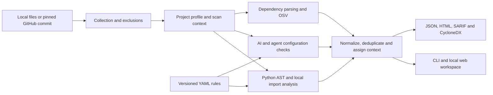

# Theron

**Evidence-driven security scanning for Python and AI application repositories.**

[](https://github.com/spideyctf/theron/actions/workflows/checks.yml)
[](LICENSE)

Theron combines bounded Python flow analysis, AI-specific checks, dependency advisory matching and a local review workspace. Scan a directory or GitHub repository, inspect the evidence, and export terminal, JSON, HTML or SARIF reports and a CycloneDX SBOM.

**Status:** a working research prototype with reproducible synthetic results. Findings require review. The strongest measured coverage is command/code injection, SQL injection and deserialization; stored XSS remains a major gap.

**Platform direction:** Theron's broader goal is unified, evidence-driven security analysis across application code, dependencies, secrets, infrastructure, AI pipelines and agents, with correlation and controlled verification added in stages. The [platform contract, coverage matrix and ranked backlog](docs/PLATFORM.md) distinguish implemented capabilities from experimental and planned work. This vision does not expand the current coverage claims below.

## Latest evaluation: OWASP BenchmarkPython

**Real-world preparation, 12 November 2026:** [Step 2 metadata audit](docs/evaluation/realworld-2026-11-12/README.md) froze 70 Python CVEs across 48 project groups: 26 development, 9 validation, 9 test, and 26 development-only due to prior exposure. All metadata references resolve, but source/patch labels remain unverified: **0 scorable real-world cases and no new accuracy result**.

**Step 3 development checkpoint:** [source review and detector increment](docs/evaluation/development-2026-11-12/README.md) audited seven development cases (14 snapshots; 18 verified function spans). Inherited Tornado request-body analysis adds one tuning-corpus SQL detection. New Tornado/aiohttp redirect candidates remain experimental because they also flag patched normalization code. Default development-probe matches remain 1/7; reserved source stays unopened and independent labels are pending.

**Precision follow-up, 13 November 2026:** [redirect evidence review](docs/evaluation/redirect-precision-2026-11-13/README.md) adds fixed-origin proofs and reclassifies two query-only experimental candidates as explicit unknown-base notices. The remaining patched-normalization candidate stays experimental; offline URL controls do not establish deployed exploitability.

**Step 4 correlation pilot:** [MCP configuration-to-code evidence](docs/evaluation/correlation-2026-11-13/README.md) connects supported VS Code Python declarations to existing findings through fingerprints, JSON pointers and source/sink locations. Unsupported/ambiguous declarations retain reasons. Groups appear in all exports and the **MCP links** tab, with no added vulnerability counts or runtime-exposure claims.

**Step 5 evaluation, 13 November 2026:** [fresh comparison and failure analysis](docs/evaluation/step5-2026-11-13/README.md) froze implementation `36ee9ee` and reran both baselines on byte-verified inputs. Theron remains at **0% validation recall and 15.73% test recall** on the already-exposed OWASP splits. A controlled replay confirmed an old staging defect affecting nine Semgrep development outcomes; corrected results and the full history are preserved. Real-code labels remain provisional, and an [independent review worksheet](docs/evaluation/step5-2026-11-13/INDEPENDENT-REVIEW.md) is ready.

On **12 November 2026**, we added [OWASP BenchmarkPython](https://github.com/OWASP-Benchmark/BenchmarkPython), pinned to `f1291485808b66e20ddb6b01b10dc71b3df8c8ba`: **1,230 synthetic cases across 14 categories**. Whole upstream template families stay in one split: 737 development, 248 validation and 245 test cases. The detector was frozen at [`a504494`](https://github.com/spideyctf/theron/commit/a504494e35b961770a5c37896a7f115bfe025088) before validation/test; all categories, including unsupported ones, remain scored.

| Split | Before: detected / vulnerable | After: detected / vulnerable | After precision | After F1 |
| --- | ---: | ---: | ---: | ---: |
| Development | 5 / 279 (1.79%) | 56 / 279 (20.07%) | 80.00% | 32.09% |
| Validation | 0 / 84 (0.00%) | 0 / 84 (0.00%) | 0.00% | 0.00% |
| Test | 3 / 89 (3.37%) | 14 / 89 (15.73%) | 73.68% | 25.93% |

The test set has 156 fixed cases; Theron matched five before and after the change. **Validation recall is zero**, exposing unsupported categories and unmodelled flows. This is a harder template/category-shift evaluation than the earlier tuning corpus; the higher tuning recall must not be presented as general accuracy. The original before/after study below belongs to its earlier frozen detector; Step 5 reproduces these default counts as exposed regressions at `36ee9ee`.

| Frozen test comparison | TP | FN | FP | TN | Precision | Recall |
| --- | ---: | ---: | ---: | ---: | ---: | ---: |
| Theron | 14 | 75 | 5 | 151 | 73.68% | 15.73% |
| Bandit 1.9.4 | 63 | 26 | 47 | 109 | 57.27% | 70.79% |
| Semgrep CE 1.185.0, pinned Python rules | 31 | 58 | 22 | 134 | 58.49% | 34.83% |

Both baselines detect more vulnerable test cases. Theron has fewer fixed-case matches at lower coverage; this does not establish superiority. These are file/CWE case metrics from our adapter, not individual-alert exploit precision or the official OWASP scorecard. Both corpora are synthetic, with shared helpers and residual similarity risks.

Three ablations are included: helper calls, local imports and context-specific sanitizer flags. They are neutral on validation/test. On development, disabling helper calls or imports loses two detections; disabling sanitizer flags adds eight false-positive cases. No held-out benefit is attributed to those features without supporting evidence.

See the [frozen protocol](docs/evaluation/owasp-2026-11-12/README.md), [complete results](docs/evaluation/owasp-2026-11-12/RESULTS.md), [machine-readable summary and cluster intervals](docs/evaluation/owasp-2026-11-12/summary.json), and [research plan](docs/RESEARCH.md). The reported test set is now exposed; future tuning against it needs a new untouched final evaluation.

## PySASTBench tuning benchmark

Re-evaluated **13 November 2026** after the Step 3 framework-source and redirect-precision changes, using default SAST rules and pinned [PySASTBench](https://github.com/Victor725/PySASTBench). This increment follows the older frozen OWASP detector; the OWASP numbers above remain historical results for that detector. The tuning corpus contains 120 vulnerable/fixed pairs across six CWEs. One vulnerable label cannot be resolved, leaving **119 scorable vulnerable variants and 120 fixed variants**.

| Measure | Result |
| --- | ---: |
| True positives / false negatives | 93 / 26 |
| Label-matched false positives / true negatives | 4 / 116 |
| Recall | **78.15%** |
| Precision | **95.88%** |
| F1 | **86.11%** |
| Accuracy over 239 scored variants | 87.45% |
| Specificity | 96.67% |
| Balanced accuracy | 87.41% |
| False-positive rate on fixed variants | 3.33% |
| Unscorable vulnerable variants | 1 |
| Fixed files with any alert, including unrelated alerts | 7 / 120 |
| Total alerts across fixed files / outside label match | 8 / 4 |

These are **case-level, label-matched metrics**, not the proportion of individual real-world alerts that are exploitable. The corpus was inspected during tuning; it is not a held-out test set. The evaluator and upstream labels were not changed to improve the score. Benchmark exit code **1** records the unresolved label rather than silently dropping it.

| CWE | Category | TP | FN | FP | TN | Precision | Recall | F1 |
| --- | --- | ---: | ---: | ---: | ---: | ---: | ---: | ---: |
| 22 | Path traversal | 17 | 3 | 3 | 17 | 85.00% | 85.00% | 85.00% |
| 77 | Command injection, including CWE-78 | 19 | 0 | 0 | 20 | 100.00% | 100.00% | 100.00% |
| 79 | XSS | 2 | 18 | 0 | 20 | 100.00% | **10.00%** | 18.18% |
| 89 | SQL injection | 19 | 1 | 0 | 20 | 100.00% | 95.00% | 97.44% |
| 94 | Code injection | 18 | 2 | 0 | 20 | 100.00% | 90.00% | 94.74% |
| 502 | Unsafe deserialization | 18 | 2 | 1 | 19 | 94.74% | 90.00% | 92.31% |

CWE-77 has one additional unscorable vulnerable label. A perfect result within a small category does not establish complete coverage. The four matched fixed-case alerts remain counted as false positives: manual review found weak path-prefix guards in three and uploaded data passed to `joblib.load` in one.

| Engineering check, 13 November 2026 | Result |
| --- | --- |
| Python regression suite | 426 passed; 1 dependency deprecation warning |
| Frontend tests | 11 passed |
| TypeScript check and production build | Passed |
| CI configuration | Ubuntu and Windows; Python 3.12 and Node 22 |

Test counts measure regression checks, not detection accuracy. The badge links to current CI. See [current raw PySASTBench output](docs/evaluation/step5-2026-11-13/pysastbench-regression.json), [earlier snapshot and formulas](docs/evaluation/2026-11-12/README.md), [scoring and history](docs/PYSASTBENCH.md), and [quality limits](docs/QUALITY.md).

The earlier four-module GitHub self-scan of `ff71cf6` analyzed **76 files in 58.24 seconds**, with **1 application informational notice**, **0 application vulnerability alerts**, **18 context detections** and **151 SBOM components**, including **15 unresolved versions**. This historical, single-run smoke test predates the new flow changes; it is not a current throughput benchmark or proof of security. [Self-scan summary](docs/evaluation/2026-11-12/self-scan-summary.json).

## What Theron checks

| Module | Default coverage | Additional opt-in review candidates |
| --- | --- | --- |
| `sast` | Supported Python input flows into command/code execution, unsafe deserialization, paths, SQL/XPath statements, redirects, outbound URLs and selected HTML responses/Flask returns | Tornado/aiohttp redirect candidates; broader Python and JS/TS regex patterns |
| `ai` | Recognized provider credential patterns and model-text-to-execution flows; credential matches are explicitly unverified | Prompt/instruction patterns, deployment settings, generic credentials and exfiltration hints |
| `sca` | Exact-version OSV advisory matches, grouped aliases, unresolved-version notices and CycloneDX 1.5 inventory | AI/ML package review hints |
| `agentic` | Structured configuration parsing notices | MCP, instructions, tool descriptions and permission patterns |

Python analysis follows selected framework/CLI/socket sources, literal-key containers, selected list mutations, `ConfigParser` set/get values, nested helpers, returns, simple instance state and repository-local imports. Literal comparisons and selected `match` branches are resolved without executing code. Source/sink traces show the observed flow. Sanitizers apply to the relevant context: HTML escaping does not sanitize shell commands, and a safe filename does not make deserialization safe. Flask factory registration inferred from a route decorator and Flask APIs is explicitly medium confidence. Scanned modules are parsed as text and never imported or executed.

Passing input to an LLM, installing an AI package or naming a variable `secret` does not by itself establish a default vulnerability. JS/TS checks do not have Python-equivalent semantic analysis. Enable broader candidates with `--include-experimental` and validate them individually.

## Quick start

The package declares Python 3.9+, but the verified development/CI environment is **Python 3.12**. Use that version to reproduce these results. Frontend builds require Node.js 22.12+; this evaluation used Python 3.12.6, Node 22.17.1 and npm 11.12.0.

```powershell
git clone https://github.com/spideyctf/theron.git
cd theron
python -m venv .venv
.\.venv\Scripts\Activate.ps1
python -m pip install -e ".[web,dev]"

# Local scan: no GitHub token required
ai-sec-scan --local . --format json --output report.json

# Inspect the intentionally vulnerable demonstration
ai-sec-scan --local examples/vulnerable_repo --format html --output example-report.html
```

On Linux/macOS, activate with `source .venv/bin/activate`. Local SCA still makes OSV network requests; a local scan is not necessarily offline. See [installation details](INSTALL.md).

For GitHub scans, set `GITHUB_TOKEN` in the backend environment using a token with read access to the intended repository. Do not commit tokens or put them in frontend environment variables.

```powershell
ai-sec-scan --repo owner/repository --branch main
ai-sec-scan --repo owner/repository --modules sast,sca --format sarif --output report.sarif
ai-sec-scan --repo owner/repository --include-experimental
```

The CLI also supports `--mine`, `--user USER`, `--org ORG` and `--max-repos N`. GitHub tree/file downloads are pinned to an immutable commit, exported in the report.

## Local review workspace

Build the React frontend, then serve it with the Python API:

```powershell
cd frontend
npm ci
npm run build
cd ..
python -m scanner.web
```

Open **http://127.0.0.1:8000/**. Configure `GITHUB_TOKEN` before starting the backend for live GitHub scans. Without it, the sample report is explicitly labelled. For frontend development, run `npm run dev` inside `frontend` and use port 5173 while the API runs on port 8000.

| Tab | Data shown |
| --- | --- |
| Findings | Application detections with combined filters, evidence and remediation |
| MCP links | Experimental declaration-to-code groups, finding references, resolution reasons and uncertainty |
| Tests / examples | Retained evidence from test, example and documentation paths |
| Dependencies / SBOM | Supported package inventory, unresolved versions and complete SBOM export |
| Project profile | Detected languages, frameworks and configuration paths |
| Scan details | Commit, modules, timestamps, coverage notices and complete report data |

Finding details include confidence, maturity, scope, evidence kind, severity provenance, advisory aliases and source/sink locations when available. Source links use the scanned commit. JSON/SARIF downloads are available for completed scans. History is held in memory and resets on restart. This is a loopback-bound, single-user service. See [frontend setup and API](frontend/README.md).

## Interpreting a report

**Application and context findings:** detections in tests/examples/documentation remain available but do not contribute to application severity totals or CI failure thresholds. This uses paths and does not prove a finding is false. Review context evidence for real credentials or deployed example code. SARIF preserves it in run properties rather than application results.

**Credentials:** provider-shaped values are redacted and labelled unverified. Theron does not authenticate with discovered values. Reports can still contain source text; review before sharing.

**Dependencies:** OSV is queried for exact declared or locked versions. Ranges remain unresolved instead of being treated as installed versions. A version match does not prove vulnerable functionality is used. CVE/GHSA/PYSEC aliases are grouped per package/version/source. Severity comes from advisory metadata or scored CVSS; a missing severity gets an explicit provisional medium rating.

**Coverage notices:** parsing/read/download failures, oversized files, call-budget exhaustion, unresolved versions and advisory failures are informational evidence of incomplete analysis. Zero application alerts is not proof of security.

Supported declarations: `requirements.txt`, `package.json`, `pyproject.toml`, `go.mod` and `Pipfile`. Supported locks: npm `package-lock.json` v1/v2/v3, `npm-shrinkwrap.json` and `Pipfile.lock`. Matching lock entries take precedence over declarations in the same directory. Other lock formats and actual deployed environments are not resolved.

## Configuration and CI

Place `theron.yml` in the local scan root or CLI working directory for GitHub scans, or use `--config PATH`:

```yaml
modules: [ai, sast, sca, agentic]
exclude: []
accepted_fingerprints: []
correlation_enabled: true
```

The MCP correlation pilot adds evidence groups, not vulnerability counts. Disable it with `--no-correlation` or `correlation_enabled: false`; API scans also accept `correlation_enabled: false`.

Accepted fingerprints mark findings as existing. Exclusions omit paths before reading/downloading them. The CLI is report-only by default; opt into a failure threshold explicitly:

```powershell
ai-sec-scan --local . --fail-on high --format sarif --output report.sarif
```

Exit **0** means no configured threshold breach, **2** means a new application finding reached the threshold, and **1** is used for operational/configuration errors. Read informational notices even when the exit code is zero. The benchmark has its own error behavior below.

## Architecture and extension



Plugins live in `scanner/plugins/`. YAML rules live under `rules/<module>/v1/`; Python flow semantics live in `scanner/python_analysis.py` and `scanner/python_project.py`. Adding a YAML rule does not automatically extend semantic coverage. Use existing rule files as templates and add positive and safe-near-miss regression cases. Select custom rules with `--rules-dir PATH`.

Analysis is bounded to **five call levels**, **1,500 invocations per entry file** and **500,000 bytes per file**. Generated/configured paths are excluded. Downloads and advisory requests use bounded concurrency and timeouts.

## Reproduce the checks

```powershell
python -m pip install -e ".[web,dev]"
python -m pytest tests -q -p no:cacheprovider
cd frontend
npm ci
npm test
npm run build
cd ..

git clone https://github.com/Victor725/PySASTBench.git .benchmark-cache/PySASTBench
git -C .benchmark-cache/PySASTBench checkout 3ad04b72c516d0533a5dc9c8042c9808e69e0f40
python -m scanner.benchmark --dataset .benchmark-cache/PySASTBench --output .benchmark-cache/results.json
```

Skip cloning if the checkout already exists. The benchmark parses corpus code without executing applications. Its known `77_DS-14` function-label typo produces **exit 1** and one recorded error; inspect the output rather than changing the label. Manifest/source hashes and per-case outcomes are included in JSON. The external corpus is ignored and not bundled with Theron.

## Research status and known gaps

The current evidence supports an evaluated prototype, not an industry-grade or state-of-the-art claim. These benchmarks measure Python SAST only; they do not validate AI-specific detection accuracy, agentic checks, SCA precision, SBOM completeness or real-world exploitability. A grouped synthetic holdout, pinned baseline comparison and three ablations are now available; real-world/AI-specific holdouts, independent adjudication and a user study remain outstanding. ROC-AUC/PR-AUC are not reported because there is no ranked threshold sweep.

Major gaps include persistent/store-to-template XSS, complex mutable aliasing, dynamic dispatch/imports, third-party internals, unsupported frameworks/lockfiles, and runtime authorization or reachability. Loop handling is bounded rather than a general fixed-point analysis.

See the [research plan](docs/RESEARCH.md) for proposed experiments and publication-readiness criteria, and [quality documentation](docs/QUALITY.md) for detailed caveats.

## License

[MIT](LICENSE). Benchmark data and third-party tools retain their own licenses and attribution requirements.
