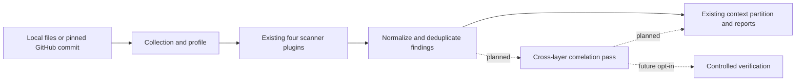

# Theron platform contract and implementation roadmap

Status: Step 1 planning checkpoint, 12 November 2026 (Asia/Calcutta).
Code/evaluation baseline inspected: `4c1bc8c83fcf27c26ac4b3f4ca3fd70a6a6a6e52`.
This document defines the target and acceptance criteria. It does not add detectors, change report schemas or establish new accuracy results.

## Platform goal

Build and evaluate Theron as a unified, evidence-driven security platform that identifies, correlates, prioritizes and helps verify vulnerabilities across application code, dependencies, secrets, infrastructure, AI pipelines and autonomous agents, providing actionable findings through a single developer workflow.

The product scope includes every layer below. Coverage will be implemented and measured incrementally, with supported formats, languages and analysis limits stated for each release. The goal is comprehensive, extensible coverage with inspectable evidence; a module name or a clean scan is not a claim that every weakness in that area is detected.

Working project/research title: **Theron: A Unified Security Analysis and Verification Platform for AI-Enabled and Agentic Software Systems**.

The proposed research contribution is whether combining these layers yields additional correctly identified risks or more accurate review decisions than the layers/tools alone. This is a hypothesis to evaluate, not an established novelty or performance claim.

## Present architecture and reuse

Reuse the existing collector, project profile, `ScanContext`, four plugins (`sast`, `ai`, `sca`, `agentic`), `Finding`/`ScanResult`, normalization, context partitioning and reporters. The initial correlation pilot should be a small post-analysis pass, using facts already available from collected files and findings. It does not require a new analysis framework or graph database.

Current implementation references: [engine](../scanner/engine.py), [models](../scanner/models.py), [profiler](../scanner/profiler.py), [plugins](../scanner/plugins/), [normalization](../scanner/finding_utils.py), [frontend API types](../frontend/src/api.ts).

## Coverage matrix

Availability and validation are separate: a default check is not automatically independently validated. “Experimental” means opt-in review candidates. “Profile” means recognizing an artifact, not testing its security.

| Area | Available now | Material gap | Next increment | Required evaluation |
| --- | --- | --- | --- | --- |
| Python application security | Default bounded input/model-to-sink analysis; selected framework APIs, helpers, imports, containers, SQL/XPath, redirects, paths and HTML responses | Low external coverage; stored XSS, dynamic dispatch, aliases and unfamiliar APIs | Fix one recurring, source-confirmed development miss at its shared cause | Independently labelled vulnerable/fixed flows plus safe near-misses; retain all misses/errors |
| Other application languages | Experimental JS/TS patterns | No Python-equivalent semantics or independent language-specific accuracy | Extend a declared language/CWE slice after the core evidence path works | Separate labelled language corpus and pinned applicable baselines |
| Dependency vulnerability analysis | Default exact-version OSV matching, advisory aliases and severity provenance | Ranges unresolved; manifest presence does not establish installed/deployed or vulnerable-function use | Link a finding to an identified package/version/source; later add supported reachability models | Version/advisory oracle fixtures; package/alias accuracy measured separately from reachability |
| SBOM and supply-chain provenance | CycloneDX inventory from supported declarations/npm/Pipfile locks | Unsupported locks; no signature/model provenance or general malicious-package verification | Add a justified lock format or provenance fact with explicit source | Independently known component inventories and exact provenance fixtures |
| Secrets | Default provider-shaped patterns, redacted evidence, unverified labels | Patterns do not establish valid credentials; placeholders and context remain difficult | Improve contextual precision and redaction without authenticating discovered values | Synthetic/non-live credential corpus; redaction assertions and safe placeholder controls |
| Containers and infrastructure | Profile flags plus some experimental deployment text checks | No comprehensive structured Docker/Compose/Kubernetes/Terraform security analyzer | Begin with explicitly configured dangerous settings in one format | Unsafe/safe config pairs, environment assumptions and parsing/unsupported-format notices |
| CI/CD and deployment | CI/config artifact profiling and ordinary source analysis | No workflow permission/data-flow model or deployment reachability proof | One supported workflow format and explicit permission/input boundaries | Labelled workflow pairs; distinguish declared configuration from deployment observations |
| LLM pipelines and model artifacts | Selected provider sources, model-text-to-execution flows and unsafe object-loader sinks | No measured AI-specific accuracy; general RAG, exfiltration and artifact authenticity unmodelled | Independently label execution/loading boundary cases and their safe alternatives | Source-reviewed AI flows; distinguish dangerous use from ordinary prompt/model/package presence |
| Agents, MCP and tools | Default malformed-config notices; experimental structured/text checks for MCP, instructions and permissions | No verified end-to-end tool/permission/exposure model; missing config auth fields do not prove missing runtime auth | Resolve an explicitly declared local entrypoint and connect supported code evidence | Exact config-to-file positives and unrelated/missing/ambiguous negatives; no commands executed |
| Cross-layer correlation and prioritization | Findings aggregated/deduplicated; code traces and profile available | No implemented correlation groups, relation evidence or calibrated combined risk | One small deterministic config-to-code pilot described below | Correct/incorrect edge labels, incremental validated findings and an ablation with correlation disabled |
| Verification | Static evidence only; scanner does not execute collected applications | No runtime reachability or controlled reproducer service | Later support bounded, isolated local verification for selected case types | Reproducer logs, limits, isolation and negative/inconclusive outcomes; a failed reproduction is not proof of safety |
| Developer workflow | CLI, local single-user web workspace, filters, JSON/HTML/SARIF, SBOM, fingerprints/baselines, CI thresholds | Memory-only web history; no persistent multi-user workflow or measured triage benefit | Expose correlation evidence through the existing report views; persistence when needed | Report round trips and UI/export agreement; reviewer experiment only if claiming review-time benefit |
| Evaluation and research | Two pinned baseline configurations, synthetic split, ablations and raw results | No independently adjudicated real-world/AI-specific result; synthetic test already exposed | Audit and partition the reserved real-world metadata before source inspection | Project-level separation, declared eligibility/labels, source/flow-level matching, uncertainty and exclusions |

The current four plugin names remain unchanged. New scope does not imply that new modules or command-line flags already exist.

## Evidence contract

Each claim must identify its input snapshot, source location, detector/configuration and the evidence supporting the claimed behavior. Missing evidence remains missing; it is not filled in with a plausible narrative.

| Evidence class | Permitted claim | Insufficient for claiming |
| --- | --- | --- |
| Observed source/configuration fact | A construct or declared value occurs at a specific location in the inspected snapshot | Runtime execution, external exposure or attacker control |
| Static inference | Supported models connect an input/value to an operation, with assumptions recorded | Proven runtime reachability or an executed exploit |
| Dependency-version match | A supported declaration/lock identifies an exact version matched by an advisory | Installation, deployment or vulnerable-function execution |
| Unverified pattern | A credential/instruction/config pattern merits review | A valid leaked key, successful prompt injection or absent runtime authentication |
| Controlled reproduction — planned | A defined behavior occurred in an identified isolated fixture/environment | Reproduction on every deployment or general exploitability |
| Unknown/incomplete | A file, relationship, analysis or verification could not be resolved | A clean negative or a confirmed relationship |

“Observed” above means observed in the inspected source/configuration unless runtime evidence is explicitly supplied. It must not be confused with runtime telemetry.

### Existing representation

Use `file_path`, `line_number`, `code_snippet`, `rule_id`, `cwe`, `trace`, `evidence_kind`, `confidence`, `maturity`, `severity_source`, `scope`, `fingerprint` and references. `ScanResult.commit_sha` identifies GitHub snapshots. Local evaluation provenance must separately pin/hash the inputs; local reports do not currently provide that full provenance automatically.

Important distinctions:

- `Finding.status` currently means **new/existing baseline status**, not verification status.
- `maturity` describes the rule's release status; it is not evidence that a particular alert is correct.
- `confidence` is categorical, not a calibrated probability. Severity describes potential impact separately.
- `scope` is path-based context, not a verdict that a fixture/example finding is false.
- Current `trace` entries are source/sink file/line records. They do not yet encode a verified execution graph or per-edge uncertainty.

### Planned additive representation for the pilot

When Step 4 is implemented, keep the original findings and add correlation groups that reference existing fingerprints **within the repository/commit/report**. Each relationship needs its kind, endpoint references, supporting file/location or structured pointer, observed/inferred/unknown classification, and limitations. Group summaries must retain uncertainty on critical links; combining weak evidence does not make it stronger.

Do not reuse `status` for reproduction. Any later verification record needs separate outcomes: not run, reproduced, not reproduced or inconclusive, with environment identity and logs. “Not reproduced” does not mean safe.

These fields are a design requirement, not implemented API fields. Before adding them, carry the change through models, normalization, engine and local CLI, JSON/HTML/SARIF/terminal output, web API/frontend types and views, and report tests. Existing JSON consumers must retain access to their current fields. SARIF context properties and application/context distinctions must remain intact. Do not add a new severity total that double-counts a group and its member findings.

## First cross-layer pilot and its boundary

Start with an MCP configuration that explicitly declares a local Python entrypoint. Resolve a supported direct Python invocation to a file within the collected repository. Relate that declaration to an existing supported dangerous code flow in that entrypoint, using its actual source/sink evidence.

The supported claim is: **this configuration declares this local entrypoint, and this inspected code has this supported dangerous flow**. Network exposure, caller authentication, effective runtime privileges and exploitability remain unknown unless separately evidenced. A package/advisory may be attached as context; it must not be described as causally involved without an independently supported link.

Acceptance cases:

1. A declared local entrypoint with a supported dangerous flow yields one inspectable correlation group referencing the original finding.
2. The same entrypoint with a safe control yields no dangerous-flow group.
3. An unsafe but unrelated file is not connected merely because it is in the same repository.
4. A missing target, unsupported wrapper/shell command, ambiguous working directory or path outside the collected project remains unresolved, with a reason.
5. Test/example evidence stays available in its own context; no application counts are inflated by the pilot fixtures.
6. No declared command, scanned module or discovered credential is executed or authenticated by the static correlation pass.

Use original local fixtures first and independently reviewed eligible development cases afterward. Fixture success validates the mechanism, not its real-world accuracy.

## Ranked backlog and dependencies

| Priority / ID | Work item | Depends on | Completion evidence |
| --- | --- | --- | --- |
| P0 / B01 | Audit metadata and freeze project groups for the 70 reserved Python CVEs; document eligibility and overlap | This contract | Pinned manifest, eligibility/exclusion reasons, development/reserve assignments; reserved bodies remain uninspected by the detector-development workflow |
| P0 / B02 | Audit a small eligible development sample and fix one recurring code-analysis gap | B01 | Confirmed source/patch-level labels, vulnerable and safe regression cases, before/after outcomes; no corpus-ID special cases |
| P0 / B03 | Implement the bounded config-to-entrypoint correlation pilot | Evidence contract; supported input/finding facts | Positive/negative/unknown edge tests and consistent exported/UI evidence |
| P0 / B04 | Evaluate the increment against pinned baselines and targeted ablations | B02/B03 | Same eligible inputs, raw outcomes/errors, matched evaluation units and honest unsupported-category reporting |
| P0 / B05 | Publish the nightly checkpoint | B04 | Tests/build as applicable, accurate README/results, reproducible commands and clean Git checkpoint |
| P1 / B06 | Add a structured infrastructure/configuration slice | Format/support contract; safe controls | Explicit-setting evidence and assumptions; no profiler flag counted as a vulnerability |
| P1 / B07 | Strengthen supported dependency inventories/provenance and code/package context | Existing SCA/SBOM; identity rules | Independent inventory/advisory fixtures; reachability claims tested separately |
| P1 / B08 | Expand independently labelled LLM/agent boundary models | AI-specific ground truth | Unsafe/safe execution, loading and tool-boundary cases, compared with applicable baseline configurations |
| P1 / B09 | Improve secret/config review precision | Non-live labelled controls | Placeholder/context handling and redaction tests; no live-credential probes |
| P2 / B10 | Extend semantic support to a justified additional language | A stable evaluated slice and evidence schema | Language-specific labels, applicable baselines and declared unsupported behavior |
| P2 / B11 | Add controlled verification for selected supported cases | Separate verification contract and isolated fixture runner | Bounded environment, logs, reproducible outcomes and explicit failure/unknown handling |
| P2 / B12 | Add durable review workflow and scale checks | Demonstrated workflow need | Persistence/recovery tests, concurrency/resource measurements and privacy boundaries |

B01 and B02 are deliberately earlier than claims about real-world gains. The reserved corpus has 70 CVEs across 48 repositories, with patch references for all entries; these metadata facts do not establish that all 70 are eligible, correctly labelled or within scope.

## Research acceptance criteria

The paper should test a concrete cross-layer hypothesis under the broad platform goal: whether supported correlation adds correctly identified, actionable risks or helps reviewers make more accurate decisions compared with the component outputs alone. Integration, a dashboard and higher alert counts are not sufficient evidence of that benefit.

- Declare supported case types and matching units before evaluating them. Audit vulnerable/fixed snapshots; do not automatically call a post-fix file clean.
- Separate projects and near-duplicates before source-driven detector tuning. Preserve reserved cases; document metadata/source exposure and who adjudicates labels.
- Compare pinned tools/configurations on the same inputs, and show support differences, errors and all relevant denominators.
- Test new mechanisms with ablations that actually remove those mechanisms. The previous neutral held-out ablations remain published.
- Report detection, false-positive behavior, evidence/edge correctness, unsupported/incomplete cases and analysis cost separately. Combined prioritization and reviewer-time benefits need their own measurements if claimed.
- Use independently reviewed labels and record unresolved/disputed cases. A second human reviewer/advisor should review the research labels; an assistant-written label is not independent validation.
- Freeze the detector before final evaluation. Current OWASP outcomes are exposed and remain regression evidence; any future tuning to them requires a fresh final evaluation.
- Treat numerical thresholds as engineering targets, not publication or industry certification. Report adverse and neutral outcomes alongside gains.

References: [current results](evaluation/owasp-2026-11-12/RESULTS.md), [reserved real-world metadata](evaluation/owasp-2026-11-12/realworld-reserve.json), [quality limits](QUALITY.md), [research plan](RESEARCH.md).

## Tonight's checkpoints and Step 1 completion

1. **Platform contract:** this goal, evidence definitions, coverage matrix, pilot boundary and ranked backlog.
2. **Real-world preparation:** B01 metadata audit and split manifest, before source inspection.
3. **Detection improvement:** B02 against eligible development cases.
4. **Correlation pilot:** B03, with its schema/report changes carried through end to end.
5. **Evaluation:** B04 with recorded failures and limitations.
6. **Delivery:** B05, using GitHub account `spideyctf` for any push.

Step 1 is complete when these planning documents are linked, their current-capability claims match the inspected code, and planning is clearly separated from implementation. Step 1 does not inspect reserved source, change detector behavior, create new accuracy results or begin Step 2 automatically.
