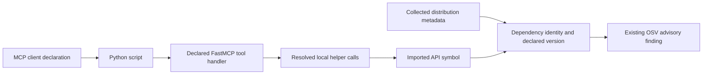

# Tool-level code, dependency and MCP evidence

15 November 2026. Initial implementation `47932f9`; current implementation `7b99d5c`. [Protocol and checkpoint history](PROTOCOL.md).

## What is implemented

Theron extends the earlier entrypoint-file and same-name-import associations with supported tool declarations and bounded local call paths:



These arrows are explicitly **static inferences**, not proof of startup, dispatch, installed packages or exploitation. The API call and the version/advisory match remain separate facts: Theron does not claim that a called API is affected when no reliable advisory-to-function mapping exists.

Supported registration forms are module-level `@server.tool()` decorators, optional literal `name`/`description` keywords, and direct `server.add_tool(function)` calls on resolved `mcp.server.fastmcp.FastMCP` or `fastmcp.FastMCP` instances. Simple instance aliases, async handlers, imported handlers and direct repository-local helper calls are supported. Other decorators, conditional registrations, late/replaced bindings and ambiguous modules retain unresolved reasons. Resource decorators are not classified as tools.

## Package attribution and provenance

- Collected `.dist-info/METADATA` and CSV `RECORD` files can associate an import root such as `yaml` with a differently named distribution such as `PyYAML`. Name/version agreement and a unique metadata claim are required. These remain artifact claims, not authenticated ownership or evidence of installation/import-path selection.
- Same-name declaration matches remain explicitly weaker context. Conflicting owners, version mismatches, local/namespace shadowing, malformed records, standard-library imports and nearer manifest boundaries prevent stronger attribution.
- Metadata files participate in ordinary local/GitHub collection; existing exclusions, including `.venv`, `vendor` and other skipped directories, still apply. No installed environment is inspected automatically. Python file records are supported; native-extension-only ownership and wheel `.data` relocation are not resolved.
- New relationships include exact call/import/definition locations, evidence basis, commit identity and source-text SHA-256 values. OSV findings now retain a digest of the grouped advisory records; joined relationships preserve it, identifiers and lookup time. The digest anchors record identity; an evaluation still needs to archive raw provider snapshots to reproduce changing database contents.
- Existing source/sink findings can be referenced from a supported handler call path. This adds no new MCP-input taint source or argument-flow proof. Original vulnerability counts, severities and fingerprints remain unchanged by correlation.

Analysis is bounded to 32 tool registrations per entrypoint, five local call levels and 256 call nodes per handler. Literal branches, direct returns, terminating if/else branches and literal empty loops are pruned. General path feasibility, object dispatch, callbacks, runtime monkeypatching and exception semantics remain incomplete. Multiple server instances in a script do not establish which instance a running client reaches.

The frontend displays function/API symbols, attribution basis, unresolved reasons and expandable provenance. JSON/API, SARIF run properties, standalone HTML and terminal correlation output preserve the graph. The CLI collection/export controls exercise the full local pipeline.

## Results

| Check | Result | Meaning |
| --- | --- | --- |
| Python regression | **823 pass**, one dependency deprecation warning | Current engineering checkpoint |
| Frontend | **19 pass; production build passes** | Symbols, metadata, provenance, unresolved states and existing views tested |
| Original tool-context controls | **16/16 expected outcomes** | Four positive context cases and 12 negative cases; not independent edge accuracy |
| Input ablations | Code only; dependencies only; code/dependencies without client configuration; combined | Required-input exercise; missing configuration prevents configured-entrypoint groups by design |
| Full correlation enabled/disabled | Original finding payloads unchanged in all 16 controls | No manufactured vulnerability discovery or severity increase |
| Upstream source compatibility | One tool each in two pinned SDK examples: `name_shrimp`, `add` | Unchanged source with researcher-generated client configuration; no advisories or vulnerabilities asserted |

[Current controls and four-mode outputs](followup/controls.json), [current upstream compatibility](followup/upstream-compatibility.json), [source receipts](upstream-source-receipts.json). Initial results at `47932f9` remain in [controls.json](controls.json) and [upstream-compatibility.json](upstream-compatibility.json). The later control-flow precision fix addresses original counterexamples; it does not tune to the upstream example outcomes.

The controls use fictional `TEST-OSV` advisories and package metadata. The SDK project was previously exposed, and the example configurations were generated for this check. Neither dataset is an untouched project-separated holdout. No additional vulnerabilities, improved reviewer decisions or real-world prioritization benefit has been demonstrated. The older detection benchmark and ten-project mechanism results are not rescored or improved by these correlation checks.

The two SDK examples declare tools but do not contain a server run call. Generated direct-Python declarations are static harness inputs, not verified runnable MCP client setups. The compatibility check therefore supports declaration parsing, not server startup or dispatch.

## Reproduction

```powershell
python -m pytest tests -q -p no:cacheprovider
python -m scripts.evaluate_tool_evidence controls
python -m scripts.evaluate_tool_evidence upstream
cd frontend
npm test
npm run build
```

The driver checks the current frozen scanner revision. The upstream mode requires the original source cache at `.benchmark-cache/tool-correlation-2026-11-15/`, with the Git blob/SHA-256 values in the receipts. It fails on missing/changed source instead of substituting a newer version. No upstream module, client command or server is executed. Controls use archived fictional advisory data and make no OSV requests.

## Remaining research work

Register a fresh real-repository study with independently supported tool/handler/call/package/advisory labels before inspecting its source. Compare applicable baselines and component ablations, count wrong associations and unresolved cases, and measure a supported decision or prioritization benefit. Installed-environment attribution, affected-function mapping, richer MCP launch/registration forms and runtime validation need separate evidence before stronger claims.

Contract references: [official MCP Python SDK](https://github.com/modelcontextprotocol/python-sdk), [Python distribution metadata specification](https://packaging.python.org/en/latest/specifications/recording-installed-packages/).
